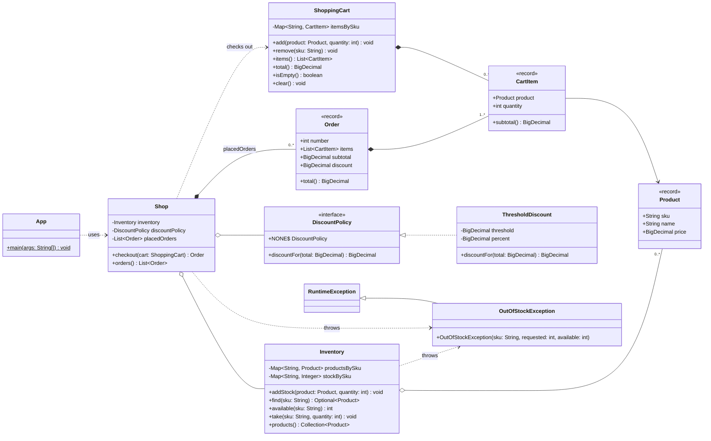
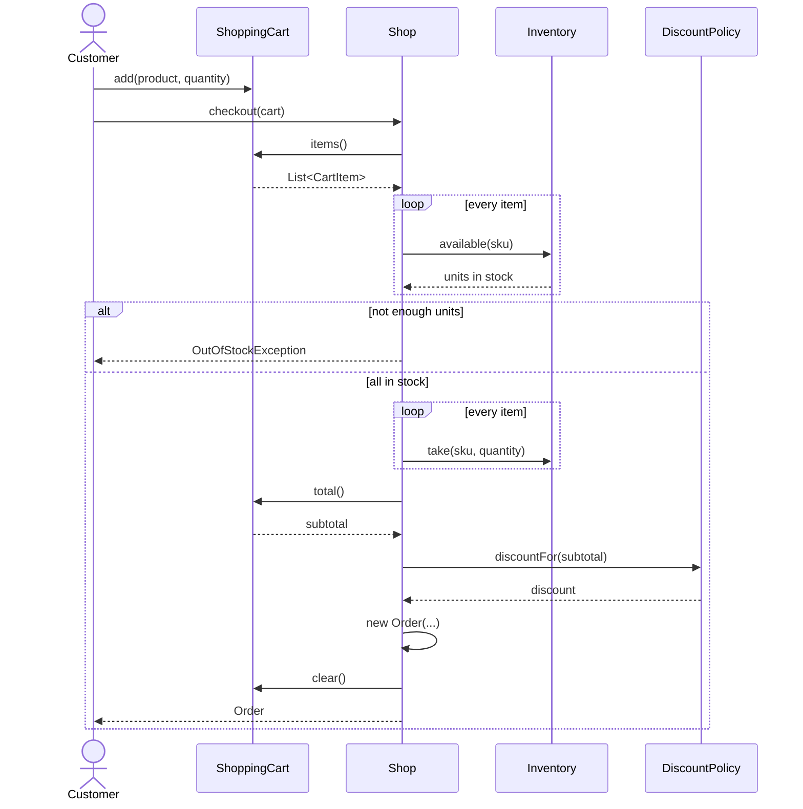

# Task 7 – Shop application

A small console shop written in Java. It brings together all the tools from list 1:

| Tool       | Where it is used                                                              |
|------------|-------------------------------------------------------------------------------|
| Maven      | `pom.xml` – build, JUnit 5 tests, executable jar, Checkstyle and PMD plugins  |
| Git        | the project is a Git repository, pushed to GitHub                             |
| PMD        | `pmd-ruleset.xml`, `pmd:check` bound to the `verify` phase                    |
| Checkstyle | `checkstyle.xml`, `checkstyle:check` bound to the `validate` phase            |
| UML        | Mermaid class and sequence diagrams below                                     |

## How it works

`Inventory` keeps products and their stock. A customer fills a `ShoppingCart`,
and `Shop.checkout()` turns the cart into an `Order`: it checks that every product
is in stock (otherwise nothing is taken and `OutOfStockException` is thrown), removes
the units from the inventory and applies a `DiscountPolicy`. `ThresholdDiscount`
gives a percentage off when the total reaches a threshold.

## Build and run

```bash
mvn verify
```

`verify` compiles the code, runs the tests, Checkstyle (validate phase) and PMD
(verify phase). The build fails on any style error or PMD violation.

```bash
java -jar target/shop.jar
```

Reports:

```bash
mvn checkstyle:checkstyle pmd:pmd
```

They are written to `target/reports/checkstyle.html` and `target/reports/pmd.html`.

In VS Code the same commands are available under *Terminal → Run Task*
(`.vscode/tasks.json`); Checkstyle and PMD violations go to the Problems panel.

## PMD findings fixed during development

The first `mvn verify` reported 52 PMD violations. Fixed in code:

- `AvoidFieldNameMatchingMethodName` – fields `items`, `products`, `orders` had the same
  names as their getters, renamed to `itemsBySku`, `productsBySku`, `placedOrders`.
- `AvoidLiteralsInIfCondition` – `quantity < 1` changed to `quantity <= 0`.
- `CloseResource` – a `PrintStream` wrapping `System.out` was never closed, removed.

Disabled in `pmd-ruleset.xml` (with a comment for each): `MethodArgumentCouldBeFinal`,
`LocalVariableCouldBeFinal`, `ShortClassName`, `UseConcurrentHashMap`.

## Class diagram



## Sequence diagram – checkout


