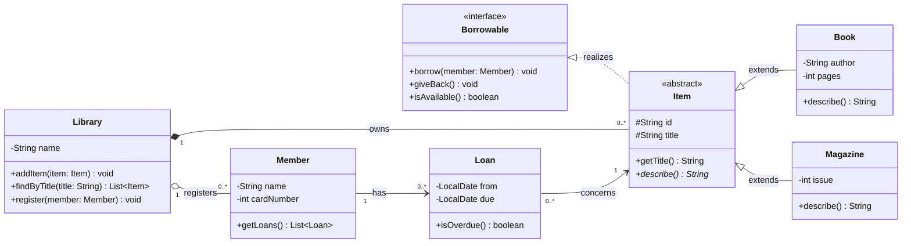

# Task 6 – UML diagrams (Mermaid)

Mermaid describes diagrams as text inside Markdown code blocks. Because the source is
plain text, diagrams live in the repository next to the code, show up in `git diff`,
and GitHub renders them automatically in README files.

## Installation in VS Code

Extension **Markdown Preview Mermaid Support** (`bierner.markdown-mermaid`):

```bash
code --install-extension bierner.markdown-mermaid
```

Open this file and press `Ctrl+Shift+V` (or `Ctrl+K V` for a side-by-side preview).
Every ` ```mermaid ` block is rendered as a diagram.

## Class diagram

Example model of a small library system. It shows the main UML relationships:
interface realization, inheritance, composition, aggregation and association.



## Notation cheat sheet

| Mermaid | UML meaning |
| ------- | ----------- |
| `A <\|-- B` | B inherits from A |
| `A <\|.. B` | B implements interface A |
| `A *-- B` | composition (A owns B, B dies with A) |
| `A o-- B` | aggregation (A groups B, B lives on its own) |
| `A --> B` | directed association |
| `A ..> B` | dependency |
| `+ - # ~` | public, private, protected, package |
| `method()*` / `field$` | abstract / static |
