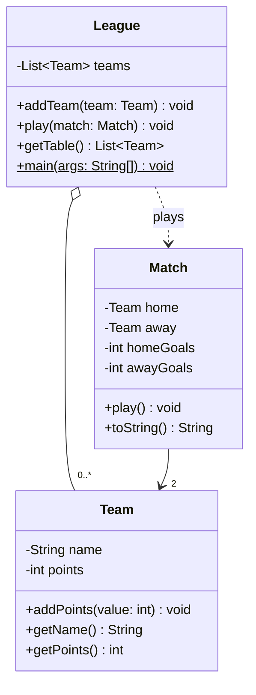
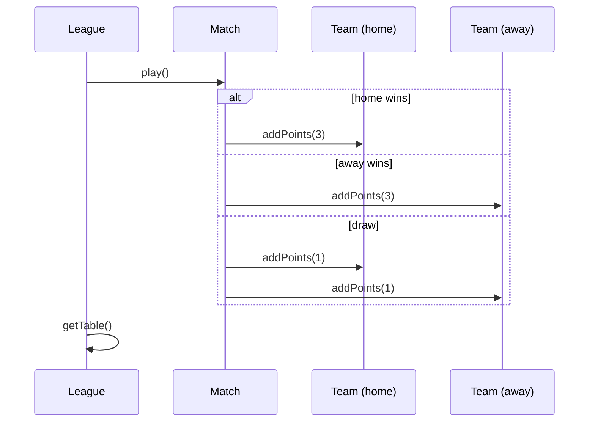

# Task 7 – Football league

A minimal Java application with three classes that shows Maven, Git, PMD, Checkstyle and UML.

## Classes

- `Team` – a team name and its points.
- `Match` – two teams and the score; `play()` gives 3 points for a win, 1 each for a draw.
- `League` – a list of teams, plays matches, returns the table sorted by points; has `main`.

## Tools

| Tool       | Where                                                                |
|------------|----------------------------------------------------------------------|
| Maven      | `pom.xml` – build, JUnit tests, executable jar, Checkstyle and PMD   |
| Git        | part of the `laboratories3` repository on GitHub                     |
| Checkstyle | `checkstyle.xml`, runs in the `validate` phase                       |
| PMD        | `pmd-ruleset.xml`, runs in the `verify` phase                        |
| UML        | Mermaid diagrams below                                               |

## Build and run

```bash
mvn verify
```

```bash
java -jar target/football.jar
```

`mvn verify` fails if a test fails, or if Checkstyle or PMD finds a problem.
For example, removing the braces around an `if` in `Match.play()` breaks the
Checkstyle rule `NeedBraces`.

## Class diagram



## Sequence diagram


