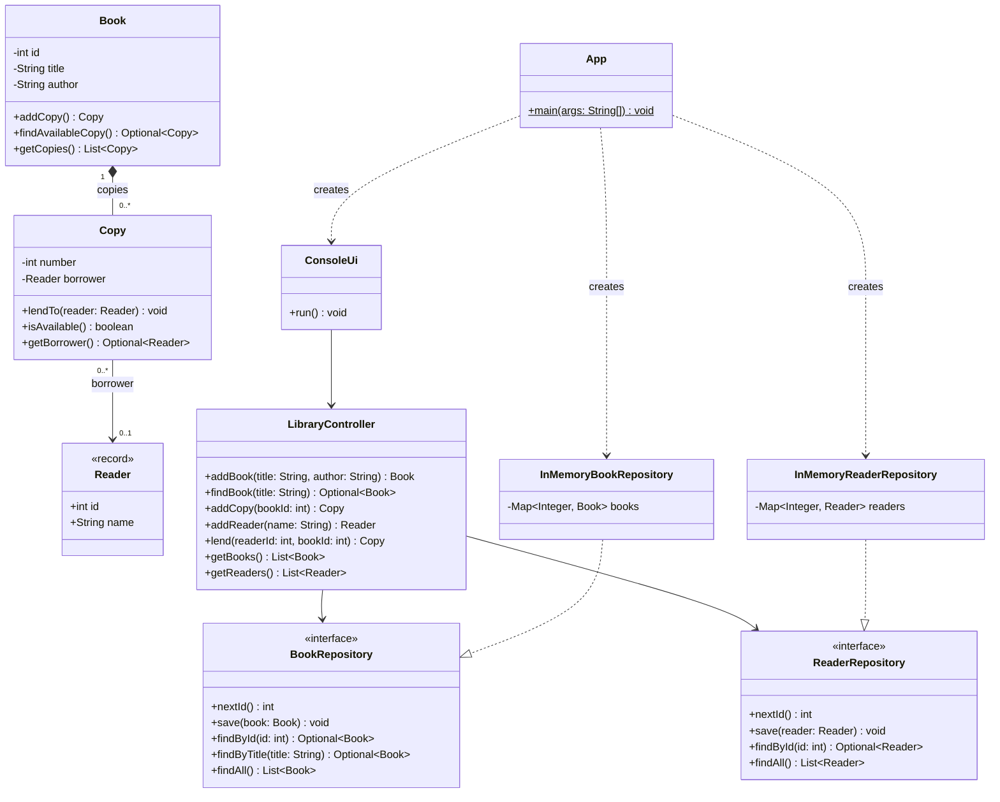
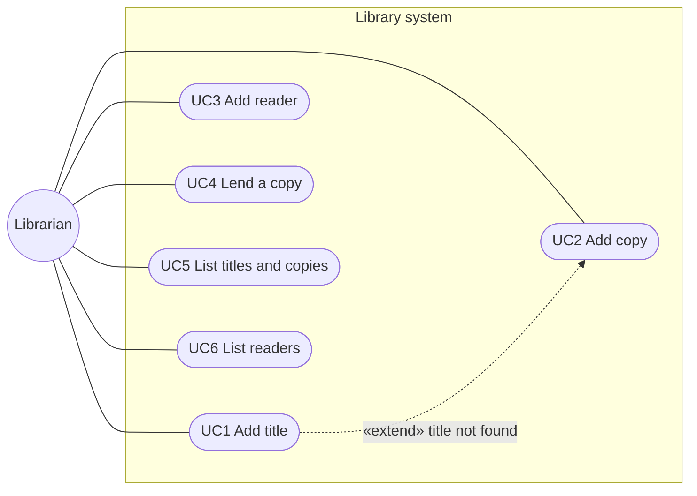

## Build and run

```bash
mvn verify
```

```bash
java -jar target/library.jar
```

`mvn verify` runs Checkstyle (`validate` phase), the JUnit tests and PMD (`verify` phase).
The build fails on a failing test, a Checkstyle warning or a PMD violation.

Example session:

```text
Choice: 2
Title: Lalka
New title, author: Bolesław Prus
Added copy #1 of [1] "Lalka" by Bolesław Prus
Choice: 4
Reader id: 1
Book id: 1
Lent copy #1
Choice: 5
[1] "Lalka" by Bolesław Prus
    #1 lent to [1] Jan Kowalski
```

## Project structure

```text
src/main/java/pl/pwr/tp/library/
  App.java                         composition root, picks the storage
  domain/        Book, Copy, Reader          the only 3 domain classes
  controller/    LibraryController           system operations (GRASP Controller)
  repository/    BookRepository, ReaderRepository          storage abstractions
  repository/memory/  InMemoryBookRepository, InMemoryReaderRepository
  ui/            ConsoleUi                   console menu
```

`Book` is a title with its list of copies, `Copy` is a physical copy, `Reader` is a person
who borrows copies. There is no separate `Loan` class: a loan is the `borrower` of a copy.

## Class diagram



## Use case diagram




The only actor is the librarian, who operates the console. Readers do not use the system
themselves; they are data the librarian enters.

## Use case scenarios

Common to all: the application shows the main menu and returns to it after each use case.

### UC1 Add title

- **Actor:** Librarian
- **Preconditions:** none
- **Main flow:**
  1. The librarian chooses "Add title".
  2. The system asks for the title and the author, and the librarian enters them.
  3. The system gives the title the next id, saves it and prints `Added title [id] "title" by author`.
- **Postconditions:** a new title with no copies is stored.

### UC2 Add copy

- **Actor:** Librarian
- **Preconditions:** none
- **Main flow:**
  1. The librarian chooses "Add copy".
  2. The system asks for the title and the librarian enters it.
  3. The system finds the title.
  4. The system creates a copy with the next copy number of that title and prints
     `Added copy #number of [id] "title" by author`.
- **Alternative flows:**
  - 3a. The title does not exist (extends with UC1): the system asks for the author, saves the
    new title and continues at step 4.
- **Postconditions:** the title has one more available copy.

### UC3 Add reader

- **Actor:** Librarian
- **Preconditions:** none
- **Main flow:**
  1. The librarian chooses "Add reader".
  2. The system asks for the name and the librarian enters it.
  3. The system gives the reader the next id, saves them and prints `Added reader [id] name`.
- **Postconditions:** a new reader is stored.

### UC4 Lend a copy

- **Actor:** Librarian
- **Preconditions:** the reader and the title exist; their ids are shown by UC5 and UC6.
- **Main flow:**
  1. The librarian chooses "Lend a copy".
  2. The system asks for the reader id and the book id, and the librarian enters them.
  3. The system takes the first available copy of the title, marks it as lent to the reader
     and prints `Lent copy #number`.
- **Alternative flows:**
  - 2a. An id is not a number: the system prints an error, nothing changes.
  - 3a. There is no reader or no title with that id: the system prints an error, nothing changes.
  - 3b. All copies of the title are lent: the system prints
    `Error: No available copy of title`, nothing changes.
- **Postconditions:** the copy is lent to the reader. A reader can hold several copies.

### UC5 List titles and copies

- **Actor:** Librarian
- **Preconditions:** none
- **Main flow:**
  1. The librarian chooses "List titles and copies".
  2. For every title the system prints its id, title and author, then every copy with its
     number and state ("available" or "lent to [id] name").
- **Postconditions:** nothing changes.

### UC6 List readers

- **Actor:** Librarian
- **Preconditions:** none
- **Main flow:**
  1. The librarian chooses "List readers".
  2. The system prints the id and the name of every reader.
- **Postconditions:** nothing changes.

## GRASP

| Principle | Where | Why |
|-----------|-------|-----|
| Information Expert | `Copy` | It holds the borrower, so it knows whether it is available. |
| Information Expert | `Book` | It holds the list of copies, so it finds an available copy. |
| Creator | `Book.addCopy()` | A book aggregates its copies, so it creates them. The `Copy` constructor is package-private, so nothing else can. |
| Controller | `LibraryController` | The single object behind the UI that receives every system operation. It only loads data, delegates to `Book`/`Copy` and saves. |
| Pure Fabrication | repositories, `ConsoleUi` | Invented classes for storage and console I/O, so domain classes contain no such code. |
| Protected Variations | `BookRepository`, `ReaderRepository` | Storage can vary (memory, SQL, MongoDB); the variation is hidden behind interfaces. |
| Low Coupling | whole design | The UI knows only the controller, the controller knows only repository interfaces, `Reader` knows nothing about copies. |
| High Cohesion | whole design | Each class has one job: domain rules, coordination, storage or console I/O. |

Dependency Inversion: the high-level `LibraryController` and the low-level
`InMemory*Repository` classes both depend on the `*Repository` interfaces. Only `App` knows
the concrete classes.

## Adding a database

1. Add a JDBC driver (for example `org.postgresql:postgresql`) to `pom.xml`.
2. Create a package `repository/jdbc` with `JdbcBookRepository implements BookRepository` and
   `JdbcReaderRepository implements ReaderRepository`.
3. In `App`, pass the JDBC repositories to `LibraryController` instead of the in-memory ones.


A possible schema:

```sql
CREATE SEQUENCE book_seq;
CREATE SEQUENCE reader_seq;

CREATE TABLE reader (
    id   INT PRIMARY KEY,
    name VARCHAR(200) NOT NULL
);

CREATE TABLE book (
    id     INT PRIMARY KEY,
    title  VARCHAR(200) NOT NULL,
    author VARCHAR(200) NOT NULL
);

CREATE TABLE copy (
    book_id     INT NOT NULL REFERENCES book (id),
    number      INT NOT NULL,
    borrower_id INT REFERENCES reader (id),
    PRIMARY KEY (book_id, number)
);
```

A sketch of the repository:

```java
public class JdbcBookRepository implements BookRepository {

    private final DataSource dataSource;

    public JdbcBookRepository(DataSource dataSource) {
        this.dataSource = dataSource;
    }

    @Override
    public int nextId() {
        // SELECT nextval('book_seq')
    }

    @Override
    public void save(Book book) {
        // upsert the book row, then one copy row per book.getCopies()
        // with borrower_id = copy.getBorrower().map(Reader::id)
    }

    @Override
    public Optional<Book> findById(int id) {
        // SELECT the book and its copies ordered by number, then rebuild it:
        // new Book(...), book.addCopy() for every row, copy.lendTo(reader) where borrower_id is set
    }

    // findByTitle and findAll work the same way
}
```

## Tools

| Tool       | Where                                                                |
|------------|----------------------------------------------------------------------|
| Maven      | `pom.xml` – build, JUnit 5 tests, executable jar, Checkstyle and PMD |
| Checkstyle | `checkstyle.xml`, runs in the `validate` phase                       |
| PMD        | `pmd-ruleset.xml`, runs in the `verify` phase                        |
| UML        | Mermaid diagrams above                                               |
