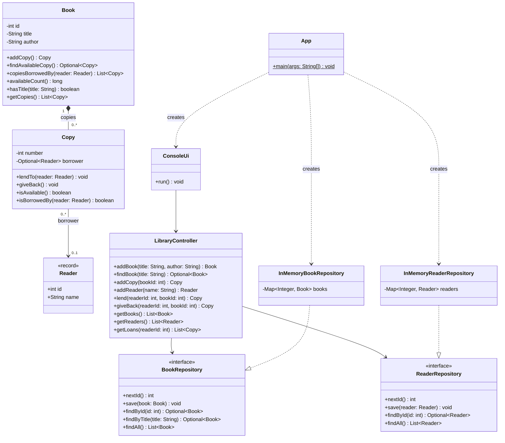
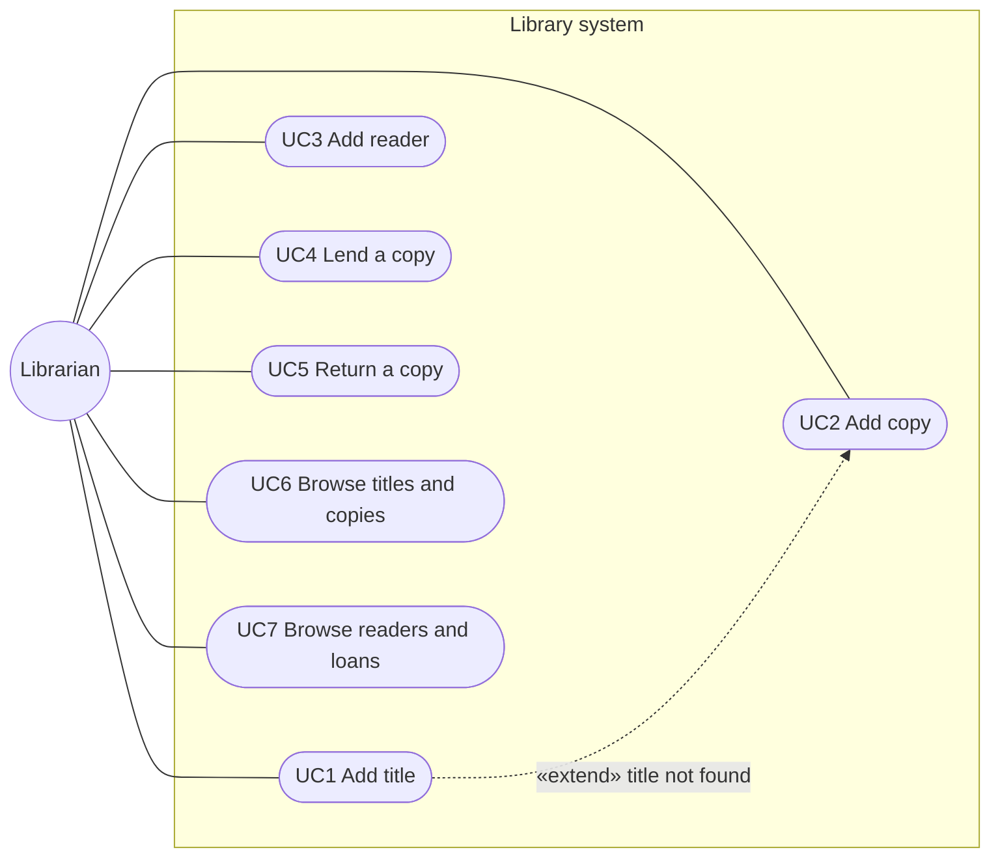

# List 2 – Book lending

Technologie programowania 2026, list 2 (TPLab02), task 1.

A console application for a small library. A librarian can add book titles, add copies of a
title, add readers, lend copies to readers, take them back and browse everything. Data is kept
in memory only, but the storage sits behind interfaces, so a database can be added without
touching the domain, the controller or the UI.

## Build and run

```bash
mvn verify
```

```bash
java -jar target/library.jar
```

`mvn verify` compiles the code, runs Checkstyle (`validate` phase), the JUnit tests and PMD
(`verify` phase). The build fails on a failing test, a Checkstyle warning or a PMD violation.
The current state is 31 tests, 0 Checkstyle warnings, 0 PMD violations.

Example session (menu omitted):

```text
Choice: 2
Title: Lalka
Title not found, adding it.
Author: Bolesław Prus
Added title [1] "Lalka" by Bolesław Prus
Added copy "Lalka" #1
Choice: 4
Reader id: 1
Book id: 1
Lent "Lalka" #1 to Jan Kowalski
Choice: 7
[1] Jan Kowalski - loans: "Lalka" #1
```

## Project structure

```text
src/main/java/pl/pwr/tp/library/
  App.java                         composition root, picks the storage
  domain/        Book, Copy, Reader          the only 3 domain classes
  controller/    LibraryController           system operations (GRASP Controller)
  repository/    BookRepository, ReaderRepository          storage abstractions
  repository/memory/  InMemoryBookRepository, InMemoryReaderRepository
  ui/            ConsoleUi                   console menu
src/test/java/pl/pwr/tp/library/   unit tests for every layer
```

The domain has only three classes. `Book` is a title (author, list of copies), `Copy` is a
physical copy of a title, `Reader` is a person who borrows copies. There is no separate `Loan`
class: a loan is the `borrower` of a copy, the same thing a `borrower_id` foreign key would be
in a database.

## Class diagram



## Use case diagram

Mermaid has no use case diagram type, so this is a flowchart drawn in the same notation:
an actor, the system boundary and use cases as ovals.



The only actor is the librarian, who operates the console. Readers do not use the system
themselves; they are data the librarian enters.

## Use case scenarios

Common to all: the application is running and shows the main menu. After the use case ends the
menu is shown again. Wherever the system asks for text, an empty line makes it ask again.
Wherever it asks for a number, any other input prints "Please enter a number" and it asks again.

### UC1 Add title

- **Actor:** Librarian
- **Preconditions:** none
- **Main flow:**
  1. The librarian chooses "Add title".
  2. The system asks for the title and the librarian enters it.
  3. The system asks for the author and the librarian enters it.
  4. The system gives the title the next free id, saves it and prints
     `Added title [id] "title" by author`.
- **Alternative flows:**
  - 4a. A title with the same name already exists (case is ignored): the system prints an error,
    nothing is saved.
- **Postconditions:** a new title with no copies is stored.

### UC2 Add copy

- **Actor:** Librarian
- **Preconditions:** none
- **Main flow:**
  1. The librarian chooses "Add copy".
  2. The system asks for the title and the librarian enters it.
  3. The system finds the title (case is ignored).
  4. The system creates a copy with the next copy number of that title and prints
     `Added copy "title" #number`.
- **Alternative flows:**
  - 3a. The title does not exist (extension point of UC1): the system prints
    "Title not found, adding it.", asks for the author and adds the title as in UC1 step 4.
    The flow continues at step 4 with the new title.
- **Postconditions:** the title has one more available copy.

### UC3 Add reader

- **Actor:** Librarian
- **Preconditions:** none
- **Main flow:**
  1. The librarian chooses "Add reader".
  2. The system asks for the name and the librarian enters it.
  3. The system gives the reader the next free id, saves them and prints
     `Added reader [id] name`.
- **Alternative flows:** none apart from the common empty-input rule.
- **Postconditions:** a new reader with no loans is stored.

### UC4 Lend a copy

- **Actor:** Librarian
- **Preconditions:** the reader and the title exist; the librarian can look up their ids with
  UC6 and UC7.
- **Main flow:**
  1. The librarian chooses "Lend a copy".
  2. The system asks for the reader id and the librarian enters it.
  3. The system asks for the book id and the librarian enters it.
  4. The system picks the first available copy of the title, marks it as lent to the reader and
     prints `Lent "title" #number to name`.
- **Alternative flows:**
  - 4a. There is no reader with that id: the system prints an error, nothing changes.
  - 4b. There is no title with that id: the system prints an error, nothing changes.
  - 4c. All copies of the title are lent: the system prints
    `Error: No available copy of "title"`, nothing changes.
- **Postconditions:** the copy is lent to the reader. A reader can hold any number of copies,
  including several copies of the same title.

### UC5 Return a copy

- **Actor:** Librarian
- **Preconditions:** the reader has a copy of the title.
- **Main flow:**
  1. The librarian chooses "Return a copy".
  2. The system asks for the reader id and the librarian enters it.
  3. The system asks for the book id and the librarian enters it.
  4. The system finds a copy of that title lent to the reader, marks it as available and prints
     `Returned "title" #number`.
- **Alternative flows:**
  - 4a. There is no reader with that id: the system prints an error, nothing changes.
  - 4b. There is no title with that id: the system prints an error, nothing changes.
  - 4c. The reader has no copy of this title: the system prints an error, nothing changes.
- **Postconditions:** the copy is available again.

### UC6 Browse titles and copies

- **Actor:** Librarian
- **Preconditions:** none
- **Main flow:**
  1. The librarian chooses "List titles and copies".
  2. For every title the system prints its id, title, author, number of copies and number of
     available copies, then every copy with its number and state ("available" or
     "lent to [id] name").
- **Alternative flows:**
  - 2a. There are no titles: the system prints "No titles".
- **Postconditions:** nothing changes.

### UC7 Browse readers and loans

- **Actor:** Librarian
- **Preconditions:** none
- **Main flow:**
  1. The librarian chooses "List readers and loans".
  2. For every reader the system prints the id, the name and the copies they hold, or "none".
- **Alternative flows:**
  - 2a. There are no readers: the system prints "No readers".
- **Postconditions:** nothing changes.

## GRASP

Each class has a one-line comment in the code naming the principle it follows. In detail:

| Principle | Where | Why |
|-----------|-------|-----|
| Information Expert | `Copy` | It holds the borrower, so it decides `isAvailable`, `lendTo`, `giveBack`, `isBorrowedBy`. |
| Information Expert | `Book` | It holds the list of copies, so it finds an available copy, a reader's copies, counts available copies and matches its title. |
| Creator | `Book.addCopy()` | A book aggregates its copies (composition), so it creates them. The `Copy` constructor is package-private, so nothing else can. |
| Controller | `LibraryController` | The single object behind the UI that receives every system operation. It only loads data, delegates to `Book`/`Copy` and saves. |
| Pure Fabrication | repositories, `ConsoleUi` | Invented classes for storage and console I/O, so domain classes contain no such code. |
| Polymorphism / Protected Variations | `BookRepository`, `ReaderRepository` | Storage can vary (memory, SQL, MongoDB); the variation is hidden behind interfaces. |
| Low Coupling | whole design | The UI knows only the controller. The controller knows only repository interfaces. `Reader` knows nothing about copies; the `Copy → Reader` link goes one way. |
| High Cohesion | whole design | Each class has one job: domain rules, coordination, storage or console I/O. |

Dependency Inversion: the high-level `LibraryController` and the low-level
`InMemory*Repository` classes both depend on the `*Repository` interfaces. Only `App` (the
composition root) knows the concrete classes.

## Adding a database

Nothing below is implemented; it shows where a database would go.

1. Add a JDBC driver (for example `org.postgresql:postgresql`) to `pom.xml`.
2. Create a package `repository/jdbc` with `JdbcBookRepository implements BookRepository` and
   `JdbcReaderRepository implements ReaderRepository`.
3. In `App`, pass the JDBC repositories to `LibraryController` instead of the in-memory ones.

The domain, the controller, the UI and their tests stay unchanged. Another kind of storage
(MongoDB, files) is one more package with two classes. Ids already come from
`Repository.nextId()`, which maps to a database sequence. The controller already calls `save`
after every change.

A possible schema:

```sql
CREATE SEQUENCE book_seq;
CREATE SEQUENCE reader_seq;

CREATE TABLE reader (
    id   INT PRIMARY KEY,
    name VARCHAR(200) NOT NULL
);

CREATE TABLE book (
    id     INT PRIMARY KEY,
    title  VARCHAR(200) NOT NULL UNIQUE,
    author VARCHAR(200) NOT NULL
);

CREATE TABLE copy (
    book_id     INT NOT NULL REFERENCES book (id),
    number      INT NOT NULL,
    borrower_id INT REFERENCES reader (id),
    PRIMARY KEY (book_id, number)
);
```

A sketch of the repository:

```java
public class JdbcBookRepository implements BookRepository {

    private final DataSource dataSource;

    public JdbcBookRepository(DataSource dataSource) {
        this.dataSource = dataSource;
    }

    @Override
    public int nextId() {
        // SELECT nextval('book_seq')
    }

    @Override
    public void save(Book book) {
        // upsert the book row, then upsert one copy row per book.getCopies()
        // with borrower_id = copy.getBorrower().map(Reader::id)
    }

    @Override
    public Optional<Book> findById(int id) {
        // SELECT the book and its copies ordered by number, then rebuild it:
        // new Book(...), book.addCopy() for every row, copy.lendTo(reader) where borrower_id is set
    }

    // findByTitle and findAll work the same way
}
```

## Tools

| Tool       | Where                                                                |
|------------|----------------------------------------------------------------------|
| Maven      | `pom.xml` – build, JUnit 5 tests, executable jar, Checkstyle and PMD |
| Checkstyle | `checkstyle.xml`, runs in the `validate` phase                       |
| PMD        | `pmd-ruleset.xml`, runs in the `verify` phase                        |
| UML        | Mermaid diagrams above                                               |
| VS Code    | `.vscode/tasks.json` – verify, PMD, run, reports                     |
